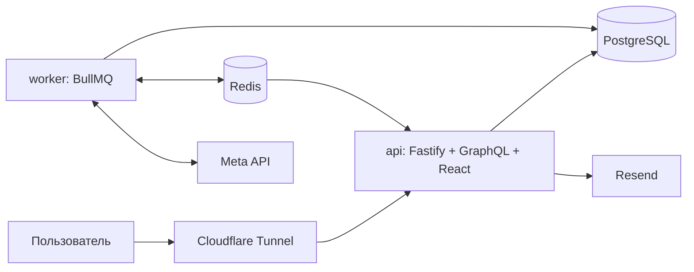

# Архитектура Buyerly

Сверено с исходным кодом после удаления Python-сервера (#611, 07.11.2026). Этот документ описывает реализацию, а не доступность внешнего Meta-приложения.

## Контуры системы

Состав production задаёт [docker-compose.yml](../docker-compose.yml): `api`, `worker`, `redis`, `db`, `backup`, `tunnel` (Cloudflare Tunnel) и одноразовый `migrate`. Один образ `buyerly-app` на `node:24-slim` с зеркала AWS ECR Public, без лимита Docker Hub ([Dockerfile](../Dockerfile)): собранный сервер на TypeScript и сборка frontend. `api` — `node server/dist/main.js`, `worker` — `node server/dist/worker/main.js`, `migrate` — `node server/dist/migrate.js`. PostgreSQL 16 хранит данные, Redis — очереди воркера и шину синхронизации; счётчики rate limit живут в памяти единственного процесса API.

### Сервер на TypeScript (#611)

Бэкенд целиком на TypeScript (записи №54 и №56 в [DECISIONS.md](DECISIONS.md)). Сервер — [server/](../server/): Fastify, graphql-yoga и TypeGraphQL, TypeORM; общие типы клиента и сервера — [packages/shared](../packages/shared/). Это npm workspaces с одним `package-lock.json` в корне. Сервис `api` (тот же адрес туннеля `http://api:8080`) отдаёт клиентский GraphQL `/api/graphql`, служебные REST-пути решения №55 — синхронизацию (`/api/sync/`: bootstrap, archived models, delta и поток изменений `/api/sync/ws`, [server/src/sync](../server/src/sync/)), OAuth Meta (`/api/meta/oauth/`), страницу приглашения, webhook Telegram-бота (`/api/telegram/webhook`), файлы `/uploads/` — а также React-сборку, публичные страницы, `/sw.js` и проверки `/health/live`, `/health/ready`, `/health/worker` ([server/src/routes](../server/src/routes/)).

Схему ведут миграции TypeORM в [server/src/migrations](../server/src/migrations/) (запись №56): первая, базовая, равна последней ревизии Alembic `0054_drop_unused_tables`; на базе, которую мигрировал Alembic, она только проверяет эту ревизию и записывается как выполненная. Каждая таблица описана сущностью TypeORM в [server/src/entities](../server/src/entities/) с `synchronize: false`. Каждая сущность реализует простой тип модели из [packages/shared/src/models.ts](../packages/shared/src/models.ts), а формы JSONB-колонок — типы из [jsonb.ts](../packages/shared/src/jsonb.ts). [server/test/schema.test.ts](../server/test/schema.test.ts) сверяет сущности со схемой, которую строят миграции: таблицы, колонки (тип, длина, `NULL`, значение по умолчанию), первичные и внешние ключи, уникальные ограничения и индексы. В CI серверный job сам мигрирует свой Postgres, поэтому миграция, которая меняет таблицу, не пройдёт CI без правки сущности, и наоборот.

### Каркас сервера

Пути, тела ответов, cookie и коды остались теми же, что до переезда: браузер не заметил смены сервера. Общий каркас, на котором стоят все области:

* **База** — `app.db.transaction(async (tx) => …)` ([server/src/database.ts](../server/src/database.ts)): явная транзакция на единицу работы. Возврат — commit, исключение — rollback. Если записи нужно сохранить и всё же ответить ошибкой (неверный код считает попытку и отвечает 401), бросается `afterCommit(new HttpError(…))`. Сырые запросы — через `rows(tx, sql, params)`: обычный `query()` TypeORM отдаёт для `UPDATE … RETURNING` пару `[rows, count]`. Чтение в одном снимке — `transaction(work, { isolation: 'REPEATABLE READ' })`.
* **Кто делает запрос** — хуки `authenticated` и `currentUser` из [server/src/auth/plugin.ts](../server/src/auth/plugin.ts) в `preValidation` маршрута (до проверки тела, поэтому без входа ответ 401, а не 422). Они кладут в `request.auth` пользователя, id сессии и слот cookie. `currentUser` дополнительно привязывает запрос к workspace из `X-Workspace-Slug` (403 `Workspace access denied`). Доступ к workspace — [server/src/workspaces/access.ts](../server/src/workspaces/access.ts) (`userWorkspace`, `userWorkspacesList`).
* **Ошибки** — `throw new HttpError(status, detail, headers?)` даёт `{"detail": "…"}`. Тела проверяются JSON Schema маршрута (`additionalProperties: false`, без приведения типов), ответ на ошибку проверки — 422 `{"detail": [{type, loc, msg, input, ctx}]}` ([server/src/http/errors.ts](../server/src/http/errors.ts)). Целые параметры строки запроса читает `integerQuery` из [server/src/http/query.ts](../server/src/http/query.ts) с тем же 422. Необработанное исключение — 500 без подробностей.
* **Адрес и лимиты** — `app.clientAddress.ip(request)` / `.location(request)` читают адрес браузера и место от Cloudflare только с адреса туннеля (`CLOUDFLARE_TUNNEL_CIDRS`) или из сетей Cloudflare ([server/src/http/client-address.ts](../server/src/http/client-address.ts)); `rateLimit({limit, scope, identityFields})` из [server/src/http/rate-limit.ts](../server/src/http/rate-limit.ts) — хук `preValidation` со скользящим окном в памяти процесса.
* **Файлы** — загрузки пользователей (аватары, логотипы) лежат в `<репозиторий>/uploads` (в Compose — том `buyerly-uploads`). Изображение проверяется по байтам и перекодируется `sharp` ([server/src/uploads/images.ts](../server/src/uploads/images.ts)); форма читается `@fastify/multipart`, `/uploads/` отдаёт `@fastify/static`.
* **Внешние службы** — `app.services` (`sendEmail`, `verifyTurnstile`); тесты подменяют их через `buildApp(config, db, { services })`.
* **Типы ответов** — в [packages/shared](../packages/shared/src/auth.ts), в именах провода (snake_case), чтобы клиент мог импортировать те же типы. Протокол синхронизации (bootstrap, delta, сообщения и коды закрытия сокета) — в [sync.ts](../packages/shared/src/sync.ts); его читает и клиент ([syncHub.ts](../frontend/src/models/syncHub.ts)), поэтому поле, переименованное на одной стороне, ломает сборку другой.
* **Поток синхронизации** — `/api/sync/ws` на `@fastify/websocket` ([server/src/routes/sync-socket.ts](../server/src/routes/sync-socket.ts), [server/src/sync/socket.ts](../server/src/sync/socket.ts)) с кодами закрытия `SYNC_CLOSE`. Журнал изменений пишут триггеры Postgres, а один хаб на процесс ([server/src/sync/hub.ts](../server/src/sync/hub.ts)) читает новые строки, когда воркер публикует `buyerly:sync_actions` в Redis ([sync/bus.ts](../server/src/sync/bus.ts)) или приходит Postgres `NOTIFY sync_actions`; опрос журнала раз в 5 секунд остаётся страховкой. Переподключённый клиент догоняет с `since` без пропусков и повторов.
* **Клиентский API (GraphQL)** — `POST /api/graphql` на graphql-yoga и TypeGraphQL ([server/src/routes/graphql.ts](../server/src/routes/graphql.ts), [server/src/graphql](../server/src/graphql/)); по решению №55 через него идёт всё приложение. Вход и CSRF проверяются до GraphQL тем же `currentUser`, что у REST (401/403 в виде REST), поэтому у каждого резолвера в `@Ctx()` есть `user`, уже привязанный к workspace из `X-Workspace-Slug`, а также `app` и запрос Fastify (`http`). Контракт схемы — [packages/shared/client-api.graphql](../packages/shared/client-api.graphql); [server/test/graphql/schema.test.ts](../server/test/graphql/schema.test.ts) сверяет с ним каждый тип и каждое корневое поле сервера (имя, аргументы со значениями по умолчанию, тип, описание).
  * **Как добавить область:** папка `server/src/graphql/areas/<область>/` с классом `@Resolver()` (`<область>.resolver.ts`) и его помощниками, одна строка в списке `RESOLVERS` ([areas/index.ts](../server/src/graphql/areas/index.ts)) — больше общих файлов область не трогает, поэтому сессии работают параллельно. Новое поле сначала появляется в `client-api.graphql` (`schema.test.ts` укажет расхождение); `input: JSON!` проверяется `inputSchema(…)` из [input.ts](../server/src/graphql/input.ts) с теми же ошибками, что 422 маршрута; отказ — `throw new RouteError(status, detail)` ([errors.ts](../server/src/graphql/errors.ts); `HttpError` общих помощников превращается в него сам), любое другое исключение — залогированный 500 «Something went wrong». Мутация отвечает `mutated(context, <Model>Payload, запись)` из [context.ts](../server/src/graphql/context.ts) после своей транзакции: `success`, `lastSyncId` и запись; все `<Model>Payload` объявлены в [payloads.ts](../server/src/graphql/payloads.ts). Тесты области — в `server/test/<область>/`. Лимиты документа: глубина 4, 10 алиасов, 2000 токенов ([limits.ts](../server/src/graphql/limits.ts)).
  * **Области:** workspaces, участники и приглашения, профиль, вход и сессии, команды, виды списков и избранное, журнал `auditEvents` и «Недавно удалённое», загрузки, подключения Meta, рекламные аккаунты (список `accounts` со сводкой, сегодняшними цифрами из fact store и здоровьем; срезы аналитики `analyticsHierarchy`, `analyticsAccountsHierarchy`; поиск `search`; остановленные ад-сеты; даты — местные дни аккаунта), Inbox и настройки уведомлений, правила, метки и превью правил — папки [server/src/graphql/areas](../server/src/graphql/areas/). Числа округляются так же, как до переезда: `pyRound` и другие помощники [python-numbers.ts](../server/src/python-numbers.ts) повторяют прежние правила округления, проверенные паритетными тестами при переносе. `adSetReactivate`, `entityDeliveryUpdate`, `entityBudgetUpdate` меняют кампании в Meta ([server/src/meta/delivery.ts](../server/src/meta/delivery.ts)): сначала читают состояние из Meta, коммитят намерение (`PENDING`) до записи и потом исход; их тест [delivery.test.ts](../server/test/meta/delivery.test.ts) идёт с Meta, которой отвечает сам тест (`meta-recorder.ts`), и сверяет запросы в Meta и историю. `auditEventUndo` — [meta/undo.ts](../server/src/meta/undo.ts) (окно 24 часа, только самое новое изменение сущности, состояние в `action_undo_states`, повтор после сбоя подтверждает уже сделанное). Превью правил считает чистая оценка движка — [server/src/rules/engine.ts](../server/src/rules/engine.ts) и [preview.ts](../server/src/rules/preview.ts): без Meta, БД и часов.
* **Аудит, корзина и доступ к аккаунтам** — общие для всех областей, не внутри папки области. Событие того, что сделал человек, пишет `recordAuditEvent(tx, …)` из [server/src/audit/events.ts](../server/src/audit/events.ts) в транзакции самого действия (свежий `correlation_id`, остальное — значения таблицы по умолчанию; `userActorId(user)` — `actor_id`). Строки журнала читаются `SELECT ${AUDIT_EVENT_COLUMNS}` и отдаются клиенту через `serializeAuditEvents` (с `can_undo` и `undo_reason`; этим же пользуется Inbox). Какие события отменяемы и до какого времени — [server/src/audit/undo.ts](../server/src/audit/undo.ts) (`REVERSIBLE_EVENT_TYPES`, `MUTATING_EVENT_TYPES`, окно 24 часа, `undoEntityIdSql`). Удаление в «Недавно удалённое» — `moveToTrash(tx, {kind, entityId, name, snapshot, …})` из [server/src/trash/trash.ts](../server/src/trash/trash.ts) в той же транзакции, что удаляет строку; срок хранения, `purgeAt`/`purgeExpired` — там же. Какие ад-аккаунты видит участник (приватные команды, гости) — `accountAccess(tx, member, workspaceId)` из [server/src/workspaces/account-access.ts](../server/src/workspaces/account-access.ts). Время в ответах форматирует Postgres (`utcIsoSql`).
* **Клиент Meta Ads API** — [server/src/meta](../server/src/meta/): версия Graph API, поля, курсорная пагинация, повторы с backoff, учёт квот (`X-App-Usage`, `X-Business-Use-Case-Usage`), `appsecret_proof` и разбор ошибок токена. [server/test/meta/client.test.ts](../server/test/meta/client.test.ts) гоняет клиент по сценариям, сгенерированным ответам и записанным прогонам fake Meta, а `fake-meta.test.ts` — против живого фейка (`server/src/scripts/fake-meta.ts`).
* **Тесты** — Vitest; HTTP-контракт в `server/test/<область>/` через [server/test/support](../server/test/support/): `Browser` хранит cookie и свой адрес, `contractTarget()` даёт сервер в процессе (`app.inject`) на базе из `SCHEMA_DATABASE_URL`. Строки создаются прямо в базе с уникальными именами, без очистки.

Сессия хранится в `web_sessions` как SHA-256 токена сессии и CSRF-токена; cookie — `buyerly_session[_N]`, `buyerly_csrf[_N]`, сессия продлевается не чаще раза в 5 минут без смены токена. Коды и ссылки входа хешируются HMAC с `OTP_PEPPER`, а выдачу кода на адрес сериализует advisory lock в Postgres.

## Frontend и HTTP

[App.tsx](../frontend/src/App.tsx) собирает React-приложение; [routing.ts](../frontend/src/lib/routing.ts) определяет публичные и workspace-маршруты как дерево React Router, [routes.tsx](../frontend/src/routes.tsx) даёт им компоненты; адрес — источник истины о текущей странице. Основные разделы — Inbox, Ads Manager, Rules и Settings. Данные хранятся в пуле моделей MobX ([pool.ts](../frontend/src/models/pool.ts)), состояние UI — в MobX-сторах рядом с ним (`frontend/src/models/*Store.ts`). Чтения вне sync и все изменения идут через клиентский GraphQL API `POST /api/graphql` ([graphql.ts](../frontend/src/lib/graphql.ts), [server/src/graphql](../server/src/graphql/), как у Linear, #509); REST ([api.ts](../frontend/src/lib/api.ts)) остаётся для sync, входа, загрузки файлов и публичных ссылок.

Vite собирает `frontend/dist`, и сервер сам отдаёт эти файлы (`SERVE_STATIC=true`, [server/src/routes/site.ts](../server/src/routes/site.ts)): сборку, юридические документы и React-приложение для любого адреса без своего маршрута, кроме корней сервера. Юридические страницы и их ресурсы находятся в `frontend/public`. Runtime-каталог `uploads/` монтируется в production как именованный том `buyerly-uploads`; публичные URL начинаются с `/uploads/`.

## Данные и доступ

Сущности [server/src/entities](../server/src/entities/) описывают пользователей, workspace, членство и приглашения; Meta connections и assets; рекламные кабинеты; правила и группы; analytics facts, snapshots, аудит и состояние выполнения.

`workspace_id` ограничивает доступ к бизнес-данным. Членство задаёт роль `owner`, `admin`, `member` или `guest` (как в Linear); backend проверяет права при чтении и изменениях. `owner_user_id` не заменяет workspace-проверку.

Основной web-вход использует email-ссылку или OTP и создаёт серверную сессию. В БД хранится хэш секрета, browser cookie защищена HttpOnly, изменения через cookie требуют CSRF. В [server/src/auth/plugin.ts](../server/src/auth/plugin.ts) также остаётся переходная обработка legacy bearer token; её наличие не означает сохранение старого интерфейса.

Схема развивается миграциями TypeORM ([server/src/migrations](../server/src/migrations/)); их применяет только одноразовый `migrate` перед запуском релиза, сервер схему не создаёт (`synchronize: false`).

## Подключение Meta и аналитика

[server/src/meta/connections.ts](../server/src/meta/connections.ts), REST-пути [routes/meta-oauth.ts](../server/src/routes/meta-oauth.ts) и область GraphQL [areas/meta](../server/src/graphql/areas/meta/) реализуют OAuth, invite-ссылки подключения, discovery, импорт, проверку и отключение. Секреты шифруются на сервере. Фактический доступ внешних профилей зависит от конфигурации и разрешений Meta, которые нельзя установить по наличию кода.

[server/src/meta/client.ts](../server/src/meta/client.ts) получает inventory и Insights, нормализует метрики, обрабатывает квоты и ошибки. Inventory и метрики периода имеют разное происхождение: отсутствие активности не означает отсутствие рекламной сущности.

Воркер пишет `AnalyticsEntityFact` ([server/src/worker/analytics-facts.ts](../server/src/worker/analytics-facts.ts)), область [accounts](../server/src/graphql/areas/accounts/) читает его. Campaigns читает его GraphQL-запросом `analyticsAccountsHierarchy` (все кабинеты одним запросом), правила и WebMCP — `analyticsHierarchy`. `SummarySnapshot` хранит сохранённую сводку аккаунта для списка `accounts`; отдельного React-экрана у неё нет. Справочник маршрутов — [API.md](API.md).

Страница поиска `/<workspace>/search` (`/` и кнопка Search workspace) ищет по Enter GraphQL-запросом `search` ([search.resolver.ts](../server/src/graphql/areas/accounts/search.resolver.ts)): кампании, ad sets и объявления из сегодняшнего инвентаря `AnalyticsEntityFact` по часам каждого кабинета (того же, что показывает Ads Manager), правила и рекламные кабинеты workspace из адреса. Результат открывается по каноническому адресу записи, и список показывает её строку.

## Правила и worker

Все фоновые задачи выполняет воркер на TypeScript ([server/src/worker](../server/src/worker/), сервис `worker`): BullMQ на Redis (запись №54), у каждой задачи своя очередь и job scheduler со своим интервалом, concurrency 1, поэтому затянувшийся запуск откладывает следующий, а не накладывается на него. Каждый запуск держит advisory-блокировку задачи в Postgres ([worker/jobs.ts](../server/src/worker/jobs.ts), `JOB_LOCKS`): два процесса воркера (старый и новый во время деплоя) не выполняют одну задачу одновременно. Новая задача: функция в `jobDefinitions` ([worker/app.ts](../server/src/worker/app.ts)), её номер блокировки в `JOB_LOCKS` и тест в `server/test/worker/`. Задачи: компактизация журнала синхронизации `sync_log_compaction` ([sync/compaction.ts](../server/src/sync/compaction.ts)), рассылка Inbox по почте, в Telegram и Web Push — `inbox_email`, `inbox_telegram`, `inbox_push` ([notifications/delivery.ts](../server/src/notifications/delivery.ts); шифрование и подпись VAPID — [web-push.ts](../server/src/notifications/web-push.ts)), `worker_watchdog` ([worker/watchdog.ts](../server/src/worker/watchdog.ts)), смена суток кабинета `account_day_boundary` ([worker/day-boundary.ts](../server/src/worker/day-boundary.ts)) и цикл мониторинга из двух задач: `account_sync` — данные (аккаунт из Meta, факты аналитики за сегодня и один закрытый день, кэш инвентаря, здоровье аккаунта; [worker/account-sync.ts](../server/src/worker/account-sync.ts)) и `monitoring` — проверки правил, их чтения и записи в Meta, история и слоты исполнения ([worker/rule-cycle.ts](../server/src/worker/rule-cycle.ts); решение — пошаговый [rules/decide.ts](../server/src/rules/decide.ts), слот PENDING фиксируется до записи в Meta). По SIGTERM (`docker stop --timeout 30`) цикл правил и синхронизация аккаунтов останавливаются на следующем шаге — никогда между захватом слота и записью в Meta, — а правила и аккаунты, до которых цикл не дошёл, снова ждут следующего воркера (#685). Данные синхронизируются не реже самого частого правила аккаунта, правила читают из Meta только нужные им окна; здоровье аккаунта пишет синхронизация, правила — только при отказе токена. После каждого удачного запуска задачи воркер публикует `buyerly:sync_actions` в Redis ([sync/bus.ts](../server/src/sync/bus.ts)), и hub синхронизации в `api` читает журнал сразу.

Правило хранится как `RulePreset`; при назначении его snapshot записывается в `Account.active_rules`. Область назначения сохраняется отдельно от определения правила. Редактирование preset обновляет назначения, сохраняя их scope.

[server/src/rules/engine.ts](../server/src/rules/engine.ts) вычисляет условия без сетевых запросов. [server/src/worker/rule-cycle.ts](../server/src/worker/rule-cycle.ts) загружает данные и расписание, выбирает подлежащие проверке правила и выполняет результат в Meta. Уровни — campaign, adset и ad; бюджетные действия ограничены adset.

`AutomationScheduleState` хранит расписание. `RuleExecutionState` хранит попытки, PENDING, cooldown и подтверждение STOP; сверка после неопределённого результата уменьшает риск повторной мутации. Cooldown может быть нулевым: механизм не гарантирует паузу между всеми успешными срабатываниями. Пока правило ждёт конца cooldown, оно не начинает подтверждение STOP и не пишет пропуски в историю.

Если на одну сущность сработало несколько правил (`RuleEngine.evaluate_all`), каждое правило «только уведомлять» срабатывает само по себе и со своим cooldown. Из действий, которые меняют сущность, за проверку выполняется одно: берётся самый сильный вид (STOP, затем уменьшение бюджета, затем увеличение), и из правил этого вида — первое, которое не на cooldown. Более слабое действие не подменяет сильное, пока то на cooldown (запись №47).

Действие правила, отменённое байером, до конца суток по часам кабинета не повторяется над той же сущностью: worker находит такие отмены в `audit_events` (успешное `UNDO_ACTION`, чьё исходное событие — `RULE_ACTION` системы) и не передаёт движку правила с этим действием для этой сущности.

[server/src/scripts/rule-simulator.ts](../server/src/scripts/rule-simulator.ts) (`node server/dist/scripts/rule-simulator.js --scenario all`, с `TEST_DATABASE_URL` и `TEST_DATABASE_DISPOSABLE=buyerly_test`) — тренажёр правил: прогоняет настоящий worker, движок и подтверждение STOP по выдуманному кабинету поминутно (задержка отчётов Meta задаётся) на одноразовой `buyerly_test` и сравнивает, на каком долларе адсет выключает Buyerly и на каком — байер, который следует тем же правилам. Правила по умолчанию — памятка NL-байера. Цифры тренажёра выдуманы: он проверяет поведение, а не пользу на живом кабинете. Сценарии (дни байера, ручная проверка каждые 15/30/60 минут, Undo, 429/503/обрывы/истёкший токен при записи) и измерения — в [PILOT_SIMULATION.md](PILOT_SIMULATION.md).

Отдельное минутное задание обрабатывает локальную смену суток кабинета по timezone Meta. Liveness heartbeat процесса и состояние полного цикла — разные сигналы; наличие heartbeat само по себе не доказывает успешную проверку всех кабинетов.

## Аудит и отмена

`AuditEvent` хранит события workspace и сведения о результате. Inbox читает его запросом `auditEvents`; это журнал активности, без вымышленных состояний прочтения или архивации.

[server/src/meta/undo.ts](../server/src/meta/undo.ts) проверяет workspace, успешность исходного действия, окно 24 часа, последующие изменения и текущее состояние Meta. Отмена поддерживаемого действия создаёт отдельное событие.

## ИИ-агент в браузере (WebMCP)

[frontend/src/webmcp/](../frontend/src/webmcp/) предлагает ИИ-агенту браузера инструменты открытого workspace через WebMCP (`document.modelContext.registerTool`): агент вызывает готовые действия Buyerly вместо поиска кнопок на экране. Нового backend API нет, только отметка: записи агента несут заголовок `X-Buyerly-Agent: webmcp`, и по нему сервер ([server/src/rules/presets.ts](../server/src/rules/presets.ts)) оставляет в Inbox строку `ASSISTANT_CREATE_RULE`, `ASSISTANT_ATTACH_RULE` или `ASSISTANT_DETACH_RULE` (категория `MANUAL_ACTION`, `details.via = "webmcp"`). Такие же изменения, сделанные человеком на странице Rules, в Inbox не пишутся. Заголовок ничего не доказывает, он только объясняет в истории, кто попросил изменение. Каждый инструмент вызывает тот же `/api/*`, что и интерфейс, поэтому сессия, CSRF, `X-Workspace-Slug` и серверные проверки роли действуют как обычно: агент может ровно то, что может этот человек.

[register.ts](../frontend/src/webmcp/register.ts) регистрирует инструменты, только если браузер поддерживает WebMCP (`document.modelContext`, в Chrome 149 — `navigator.modelContext`) и функция включена: сборкой с `VITE_WEBMCP=1` или в отдельном браузере через `localStorage.setItem('buyerly-webmcp', 'on')`. В production она выключена до ручной проверки. Инструменты живут, пока открыт их workspace: при смене workspace их снимает `AbortSignal`, а каждый запрос ещё раз проверяет, что workspace тот же. WebMCP в Chrome пока работает только с флагом `chrome://flags/#enable-webmcp-testing` или с токеном origin trial (Chrome 149–156). Токен для `https://buyerly.app` лежит в `frontend/index.html` и действует до 2026-11-17, на других адресах Chrome его игнорирует. Просроченный токен Chrome молча игнорирует, поэтому до этой даты токен нужно продлить или убрать (напоминание — в #218). Токен только открывает `document.modelContext` без флага, а инструменты по-прежнему включаются сборкой или через `localStorage`.

Инструменты ([tools.ts](../frontend/src/webmcp/tools.ts)):

- чтение: `list_ad_accounts`, `get_performance`, `list_rules`, `list_recent_rule_actions`, `list_stopped_adsets`, `describe_rule_options`;
- изменения: `create_rule` (по умолчанию `notify_only`, `turn_off` — только по явной просьбе человека), `attach_rule` (только правила-уведомления и выключения), `detach_rule`.

Перед каждым изменением человек видит окно Buyerly ([ApprovalDialog.tsx](../frontend/src/webmcp/ApprovalDialog.tsx)). Текст в нём строится из самого запроса, а не из слов агента. Параметра, пропускающего подтверждение, нет. Кнопка подтверждения становится активной через 600 мс и не срабатывает от `click()` из скрипта, а Enter и Esc отклоняют. Отказ возвращается агенту как `{"error": "User declined"}`. Подтверждённое изменение попадает в Inbox строкой «AI assistant created / attached / detached a rule» (см. выше про `X-Buyerly-Agent`).

Агенту сознательно не даны: включение и выключение автоматизации, пауза и запуск рекламы, бюджеты, бюджетные правила и правила включения, удаление правил, undo, участники, приглашения и подключения Meta. Это деньги и доступы, и решение о них остаётся за человеком в интерфейсе.

В своём браузере человек включает инструменты переключателем «Let your browser's AI assistant use Buyerly» в Settings → Preferences ([PreferencesView.tsx](../frontend/src/components/preferences/PreferencesView.tsx)). Он пишет тот же ключ `buyerly-webmcp` в `localStorage`, и [register.ts](../frontend/src/webmcp/register.ts) (`useWebMcpEnabled`) сразу регистрирует или снимает инструменты открытого workspace, в том числе в других вкладках. В браузере без WebMCP переключатель неактивен.

Chrome не сверяет аргументы агента со схемой и не передаёт агенту текст исключения. Поэтому инструменты проверяют вход сами ([input.ts](../frontend/src/webmcp/input.ts)) и возвращают ошибки значением `{"error", "status"}`. Названия из Meta попадают только в ответы инструментов, как данные с пометкой `untrustedContentHint`, и никогда — в их описания. Проверка — [scripts/webmcp-browser.mjs](../scripts/webmcp-browser.mjs): она работает с настоящим WebMCP, если он есть в браузере, а иначе с заменой, которая ведёт себя так же.

## Эксплуатация

Тесты и сборка выполняются только в GitHub Actions. Деплой main зависит от успешных тестов и выполняет серверные проверки. Подробности: [DEPLOYMENT.md](DEPLOYMENT.md), [INCIDENT_RUNBOOKS.md](INCIDENT_RUNBOOKS.md), [RELIABILITY_SLO.md](RELIABILITY_SLO.md).
