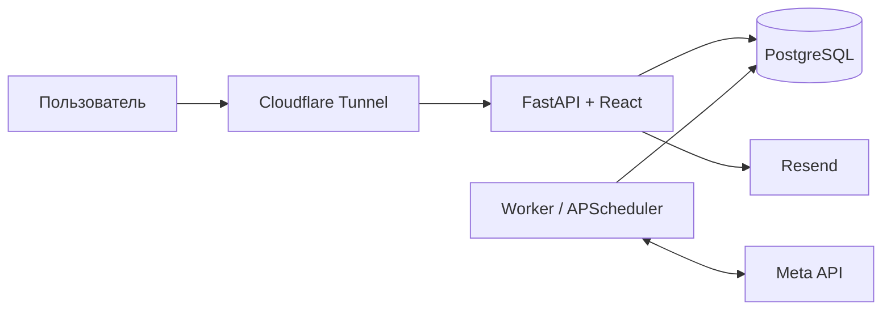

# Архитектура Buyerly

Сверено с исходным кодом после удаления legacy UI в PR #140. Этот документ описывает реализацию, а не доступность внешнего Meta-приложения.

## Контуры системы

Состав production задаёт [docker-compose.yml](../docker-compose.yml): `api`, `worker`, `server`, `db`, `tunnel` (Cloudflare Tunnel) и одноразовый `migrate`. Точки запуска находятся в `services/`. Один образ `buyerly-app`: frontend собирается на Node.js 24, код работает на Python 3.12, а новый сервер `server` — на Node.js 24 из того же образа. PostgreSQL 16 хранит данные; счётчики rate limit живут в памяти единственного процесса API.

### Переезд сервера на TypeScript (#611)

Бэкенд переносится с Python на TypeScript по областям (запись №54 в [DECISIONS.md](DECISIONS.md)). Новый сервер — [server/](../server/) (Fastify), общие типы клиента и сервера — [packages/shared](../packages/shared/). Это npm workspaces с одним `package-lock.json` в корне. Пока туннель смотрит на `api`, FastAPI сам пересылает серверу пути, которыми тот владеет ([api/server_proxy.py](../api/server_proxy.py)): префиксы перечислены в `SERVER_PATHS`, адрес сервера задан в `SERVER_URL`. Вернуть область Python — значит убрать её префикс. Сейчас серверу принадлежат его здоровье (`/health/server/`), вход, сессии, коды и Turnstile (`/api/auth/`), профиль (`/api/me`), загрузка аватара и логотипа workspace (`/api/onboarding/avatar`, `/api/onboarding/workspace/logo`), сами файлы (`/uploads/`) webhook Telegram-бота (`/api/telegram/webhook`) и синхронизация (`/api/sync/`: bootstrap, archived models, delta и поток изменений `/api/sync/ws`, [server/src/sync](../server/src/sync/)); WebSocket на этих путях API пересылает покадрово. `post_deploy_smoke.py` проверяет их через API. Python-код этих путей пока остаётся на месте для отката. Когда переедут все области, туннель переключится на `server`, а пересылка исчезнет.

База у обоих серверов одна, и схему по-прежнему ведёт Alembic. На сервере каждая таблица описана сущностью TypeORM в [server/src/entities](../server/src/entities/), с `synchronize: false` и без миграций TypeORM: сущность повторяет таблицу, а не наоборот. Каждая сущность реализует простой тип модели из [packages/shared/src/models.ts](../packages/shared/src/models.ts), а формы JSONB-колонок — типы из [jsonb.ts](../packages/shared/src/jsonb.ts). [server/test/schema.test.ts](../server/test/schema.test.ts) сверяет сущности со схемой после `alembic upgrade head`: таблицы, колонки (тип, длина, `NULL`, значение по умолчанию), первичные и внешние ключи, уникальные ограничения и индексы. В CI серверный job сам мигрирует свой Postgres, поэтому миграция, которая меняет таблицу, не пройдёт CI без правки сущности. Значения по умолчанию из `models.py` (`default=`) перенесены в инициализаторы полей, `onupdate=utcnow` — в `@BeforeUpdate`.

### Каркас сервера для переносимых областей

Каждая область переезжает на тех же путях, с теми же телами ответов, cookie и кодами: браузер не должен заметить смены сервера. Первая область (вход, #611) заложила общий каркас; следующие берут его, а не пишут свой:

* **База** — `app.db.transaction(async (tx) => …)` ([server/src/database.ts](../server/src/database.ts)): явная транзакция на единицу работы, как `async with async_session_maker()` в Python. Возврат — commit, исключение — rollback. Если записи нужно сохранить и всё же ответить ошибкой (неверный код считает попытку и отвечает 401), бросается `afterCommit(new HttpError(…))`. Сырые запросы — через `rows(tx, sql, params)`: обычный `query()` TypeORM отдаёт для `UPDATE … RETURNING` пару `[rows, count]`. Чтение в одном снимке, как `begin_snapshot` в Python, — `transaction(work, { isolation: 'REPEATABLE READ' })`.
* **Кто делает запрос** — хуки `authenticated` и `currentUser` из [server/src/auth/plugin.ts](../server/src/auth/plugin.ts) в `preValidation` маршрута (там же, где FastAPI решает зависимости: до проверки тела, поэтому без входа ответ 401, а не 422). Они кладут в `request.auth` пользователя, id сессии и слот cookie. `currentUser` дополнительно привязывает запрос к workspace из `X-Workspace-Slug` (403 `Workspace access denied`). Доступ к workspace — [server/src/workspaces/access.ts](../server/src/workspaces/access.ts) (`userWorkspace`, `userWorkspacesList`).
* **Ошибки** — `throw new HttpError(status, detail, headers?)` даёт `{"detail": "…"}`, как `HTTPException`. Тела проверяются JSON Schema маршрута (`additionalProperties: false`, без приведения типов), а ответ на ошибку проверки повторяет 422 FastAPI: `{"detail": [{type, loc, msg, input, ctx}]}` ([server/src/http/errors.ts](../server/src/http/errors.ts)). Целые параметры строки запроса (`Query(..., ge=, le=)`) читает `integerQuery` из [server/src/http/query.ts](../server/src/http/query.ts) по правилам pydantic, с тем же 422. Необработанное исключение — 500 без подробностей.
* **Адрес и лимиты** — `app.clientAddress.ip(request)` / `.location(request)` читают адрес браузера и место от Cloudflare по тем же правилам, что `core/rate_limit.py`; `rateLimit({limit, scope, identityFields})` из [server/src/http/rate-limit.ts](../server/src/http/rate-limit.ts) — хук `preValidation` со скользящим окном в памяти процесса. В Compose серверу доверена сеть `172.30.0.0/24`: его единственный клиент — API, который дописывает в `X-Forwarded-For` адрес туннеля.
* **Файлы** — загрузки пользователей (аватары, логотипы) лежат в том же каталоге, что у Python API, `<репозиторий>/uploads` (в Compose — том `buyerly-uploads` у обоих сервисов), и называются так же, поэтому файл, записанный одним сервером, читает и удаляет другой. Изображение проверяется по байтам и перекодируется `sharp` ([server/src/uploads/images.ts](../server/src/uploads/images.ts)) с лимитами `services/image_uploads.py`; форма читается `@fastify/multipart`, `/uploads/` отдаёт `@fastify/static`.
* **Внешние службы** — `app.services` (`sendEmail`, `verifyTurnstile`); тесты подменяют их через `buildApp(config, db, { services })`, как Python-тесты патчат функции.
* **Типы ответов** — в [packages/shared](../packages/shared/src/auth.ts), в именах провода (snake_case), чтобы клиент мог импортировать те же типы. Протокол синхронизации (bootstrap, delta, сообщения и коды закрытия сокета) — в [sync.ts](../packages/shared/src/sync.ts); его читает и клиент ([syncHub.ts](../frontend/src/models/syncHub.ts)), поэтому поле, переименованное на одной стороне, ломает сборку другой.
* **Поток синхронизации** — `/api/sync/ws` на `@fastify/websocket` ([server/src/routes/sync-socket.ts](../server/src/routes/sync-socket.ts), [server/src/sync/socket.ts](../server/src/sync/socket.ts)) с теми же сообщениями и кодами закрытия (`SYNC_CLOSE`), что у Python. Журнал изменений пишут триггеры Postgres, поэтому один хаб на процесс ([server/src/sync/hub.ts](../server/src/sync/hub.ts)) слушает `NOTIFY sync_actions` и раз в 5 секунд опрашивает журнал: изменения Python API и воркера доходят так же, как свои. Переподключённый клиент догоняет с `since` без пропусков и повторов. Шину заменит Redis pub/sub на этапе 4.
* **Клиентский API (GraphQL)** — `POST /api/graphql` на graphql-yoga и TypeGraphQL ([server/src/routes/graphql.ts](../server/src/routes/graphql.ts), [server/src/graphql](../server/src/graphql/)); по решению №55 через него идёт всё приложение. Вход и CSRF проверяются до GraphQL тем же `currentUser`, что у REST (401/403 в виде REST), поэтому у каждого резолвера в `@Ctx()` есть `user`, уже привязанный к workspace из `X-Workspace-Slug`, а также `app` и запрос Fastify (`http`). Схема повторяет Python-схему поле в поле: [packages/shared/client-api.graphql](../packages/shared/client-api.graphql) — напечатанная схема Python (`tests/test_client_api_sdl.py` следит, что файл свежий), а [server/test/graphql/schema.test.ts](../server/test/graphql/schema.test.ts) сверяет с ним каждый тип и каждое корневое поле TS-сервера (имя, аргументы со значениями по умолчанию, тип, описание). Пока области переезжают, `/api/graphql` целиком пересылается сюда, а документ, где есть хоть одно поле, которого здесь нет (или интроспекция, или он не разбирается), сервер передаёт Python API как есть ([server/src/graphql/routing.ts](../server/src/graphql/routing.ts), [forward.ts](../server/src/graphql/forward.ts); адрес — `API_URL`, заголовок `X-Buyerly-Server-Hop` не даёт API переслать его обратно). Значит, поле начинает отвечать с TS в тот момент, когда его резолвер зарегистрирован, без правки `SERVER_PATHS`.
  * **Как перенести область:** папка `server/src/graphql/areas/<область>/` с классом `@Resolver()` (`<область>.resolver.ts`) и его помощниками, одна строка в списке `RESOLVERS` ([areas/index.ts](../server/src/graphql/areas/index.ts)) — больше общих файлов область не трогает, поэтому сессии работают параллельно. Поле называется, принимает аргументы и описано так же, как в Python (`schema.test.ts` укажет расхождение); `input: JSON!` проверяется `inputSchema(…)` из [input.ts](../server/src/graphql/input.ts) с теми же словами pydantic, что 422 маршрута; отказ — `throw new RouteError(status, detail)` ([errors.ts](../server/src/graphql/errors.ts); `HttpError` общих помощников превращается в него сам), любое другое исключение — залогированный 500 «Something went wrong», как в Python-мосте. Мутация отвечает `mutated(context, <Model>Payload, запись)` из [context.ts](../server/src/graphql/context.ts) после своей транзакции: `success`, `lastSyncId` и запись; все `<Model>Payload` Python-схемы уже объявлены в [payloads.ts](../server/src/graphql/payloads.ts). Контрактные тесты области — в `server/test/graphql/` или `server/test/<область>/`, они идут против обоих серверов. Лимиты документа те же, что у strawberry: глубина 4, 10 алиасов, 2000 токенов ([limits.ts](../server/src/graphql/limits.ts)). Сейчас на TS: `workspaces`, `userUpdate`, виды списков (`viewSettings`, `viewSettingUpdate`, `viewSettingReset`, `workspaceViewDefaultUpdate`) избранное (`favorites`, `favoriteCreate`, `favoriteDelete`), журнал `auditEvents` и «Недавно удалённое» `deletedItems`. Рекламные аккаунты: `accountUpdate`, `accountLeadUpdate`, `accountDelete`, остановленные ад-сеты `stoppedAdSets`, `adSetDismiss` и срезы аналитики `analyticsHierarchy`, `analyticsAccountsHierarchy` (areas/accounts; даты — местные дни аккаунта, округление как `round_half_up`); `adSetReactivate`, `entityDeliveryUpdate`, `entityBudgetUpdate` меняют кампании в Meta и переезжают вместе с клиентом Meta (этап 4). Inbox (`inbox`, `inboxFacets`, `inboxSenders`, `inboxDisplay`, `inboxDisplayUpdate`, `inboxUnreadCount`, `inboxNotificationRead`, `inboxNotificationDelete`, `inboxNotificationSnooze`, `inboxDeleteAll`, `inboxDeleteAllRead`; SQL видимости, прочитанности и приоритета — [server/src/notifications/inbox.ts](../server/src/notifications/inbox.ts)) и настройки уведомлений (`notificationChannels`, колокольчик аккаунта `accountNotificationSetting`, desktop-подписка `desktopNotifications*`, Telegram `telegramConnection`, `telegramLinkCreate`, `telegramDisconnect`; [areas/notifications](../server/src/graphql/areas/notifications/), общее — [server/src/notifications](../server/src/notifications/)). Webhook бота `/api/telegram/webhook` — REST по решению №55, тоже на TS ([routes/telegram.ts](../server/src/routes/telegram.ts)); рассылка уведомлений (письма, Web Push, Telegram) остаётся у Python worker до этапа 4. `auditEventUndo` остаётся у Python до переезда клиента Meta, `deletedItemRestore` — до области правил.
* **Аудит, корзина и доступ к аккаунтам** — общие для всех областей, не внутри папки области. Событие того, что сделал человек, пишет `recordAuditEvent(tx, …)` из [server/src/audit/events.ts](../server/src/audit/events.ts) в транзакции самого действия (свежий `correlation_id`, остальное — значения таблицы по умолчанию; `userActorId(user)` — `actor_id`, как в Python). Строки журнала читаются `SELECT ${AUDIT_EVENT_COLUMNS}` и отдаются клиенту через `serializeAuditEvents` (тот же вид, что у `serialize_audit_events`, с `can_undo` и `undo_reason`; этим же пользуется Inbox). Какие события отменяемы и до какого времени — [server/src/audit/undo.ts](../server/src/audit/undo.ts) (`REVERSIBLE_EVENT_TYPES`, `MUTATING_EVENT_TYPES`, окно 24 часа, `undoEntityIdSql`). Удаление в «Недавно удалённое» — `moveToTrash(tx, {kind, entityId, name, snapshot, …})` из [server/src/trash/trash.ts](../server/src/trash/trash.ts) в той же транзакции, что удаляет строку; срок хранения, `purgeAt`/`purgeExpired` — там же. Какие ад-аккаунты видит участник (приватные команды, гости) — `accountAccess(tx, member, workspaceId)` из [server/src/workspaces/account-access.ts](../server/src/workspaces/account-access.ts), как `core/account_access.py`. Время в ответах форматирует Postgres (`utcIsoSql`), чтобы микросекунды совпали с `_utc_iso`.
* **Тесты** — HTTP-контракт в `server/test/<область>/` через [server/test/support](../server/test/support/): `Browser` хранит cookie и свой адрес, `contractTarget()` даёт этот сервер в процессе (`app.inject`) или, с `CONTRACT_TARGET=python`, работающий Python API на той же базе. Строки создаются прямо в базе с уникальными именами, без очистки. Так один набор тестов доказывает, что оба сервера отвечают одинаково; [overlap.test.ts](../server/test/auth/overlap.test.ts) проверяет, что сессия и код одного сервера действуют на другом.

Сессии общие на время переезда: `web_sessions` хранит SHA-256 токена сессии и CSRF-токена, оба сервера одинаково называют cookie (`buyerly_session[_N]`, `buyerly_csrf[_N]`), продлевают сессию не чаще раза в 5 минут и не меняют токен. Коды и ссылки входа хешируются HMAC с общим `OTP_PEPPER`, а выдачу кода на адрес сериализует одна и та же advisory lock в Postgres.

## Frontend и HTTP

[App.tsx](../frontend/src/App.tsx) собирает React-приложение; [routing.ts](../frontend/src/lib/routing.ts) определяет публичные и workspace-маршруты как дерево React Router, [routes.tsx](../frontend/src/routes.tsx) даёт им компоненты; адрес — источник истины о текущей странице. Основные разделы — Inbox, Ads Manager, Rules и Settings. Данные хранятся в пуле моделей MobX ([pool.ts](../frontend/src/models/pool.ts)), состояние UI — в MobX-сторах рядом с ним (`frontend/src/models/*Store.ts`). Чтения вне sync и все изменения идут через клиентский GraphQL API `POST /api/graphql` ([graphql.ts](../frontend/src/lib/graphql.ts), [api/client_api](../api/client_api/), как у Linear, #509); REST ([api.ts](../frontend/src/lib/api.ts)) остаётся для sync, входа, загрузки файлов и публичных ссылок.

Vite собирает `frontend/dist`, и FastAPI сам отдаёт эти файлы (`SERVE_STATIC=true`): сборку, юридические документы и React-приложение для любого адреса без своего маршрута, кроме корней сервера. Юридические страницы и их ресурсы находятся в `frontend/public`. Runtime-каталог `uploads/` монтируется в production как именованный том `buyerly-uploads`; публичные URL начинаются с `/uploads/`.

## Данные и доступ

[database/models.py](../database/models.py) определяет пользователей, workspace, членство и приглашения; Meta connections и assets; рекламные кабинеты; правила и группы; analytics facts, snapshots, аудит и состояние выполнения.

`workspace_id` ограничивает доступ к бизнес-данным. Членство задаёт роль `owner`, `admin`, `member` или `guest` (как в Linear); backend проверяет права при чтении и изменениях. `owner_user_id` не заменяет workspace-проверку.

Основной web-вход использует email-ссылку или OTP и создаёт серверную сессию. В БД хранится хэш секрета, browser cookie защищена HttpOnly, изменения через cookie требуют CSRF. В [api/auth.py](../api/auth.py) также остаётся переходная обработка legacy bearer token; её наличие не означает сохранение старого интерфейса.

Схема развивается через Alembic. Production migration runner применяет миграции под advisory lock; создание схемы через приложение не заменяет этот путь.

## Подключение Meta и аналитика

[api/meta_oauth.py](../api/meta_oauth.py) реализует OAuth, invite-ссылки подключения, discovery, импорт, проверку и отключение. Секреты шифруются на сервере. Фактический доступ внешних профилей зависит от конфигурации и разрешений Meta, которые нельзя установить по наличию кода.

[meta_api/client.py](../meta_api/client.py) получает inventory и Insights, нормализует метрики, обрабатывает квоты и ошибки. Inventory и метрики периода имеют разное происхождение: отсутствие активности не означает отсутствие рекламной сущности.

[services/analytics_store.py](../services/analytics_store.py) сохраняет и читает `AnalyticsEntityFact`. Campaigns читает его GraphQL-запросом `analyticsAccountsHierarchy` (маршрут `/api/analytics/hierarchy/accounts`, все кабинеты одним запросом), правила и WebMCP — `analyticsHierarchy` (`/api/analytics/hierarchy`). Старый account-level API `/api/summary` и `SummarySnapshot` продолжают существовать на backend; это не отдельный текущий React-экран. Справочник маршрутов — [API.md](API.md).

Страница поиска `/<workspace>/search` (`/` и кнопка Search workspace) ищет по Enter GraphQL-запросом `search` (маршрут `GET /api/search`, [api/routers/search.py](../api/routers/search.py)): кампании, ad sets и объявления из сегодняшнего инвентаря `AnalyticsEntityFact` по часам каждого кабинета (того же, что показывает Ads Manager), правила и рекламные кабинеты workspace из адреса. Результат открывается по каноническому адресу записи, и список показывает её строку.

## Правила и worker

Правило хранится как `RulePreset`; при назначении его snapshot записывается в `Account.active_rules`. Область назначения сохраняется отдельно от определения правила. Редактирование preset обновляет назначения, сохраняя их scope.

[rules/engine.py](../rules/engine.py) вычисляет условия без сетевых запросов. [scheduler/worker.py](../scheduler/worker.py) загружает данные и расписание, выбирает подлежащие проверке правила и выполняет результат в Meta. Уровни — campaign, adset и ad; бюджетные действия ограничены adset.

`AutomationScheduleState` хранит расписание. `RuleExecutionState` хранит попытки, PENDING, cooldown и подтверждение STOP; сверка после неопределённого результата уменьшает риск повторной мутации. Cooldown может быть нулевым: механизм не гарантирует паузу между всеми успешными срабатываниями. Пока правило ждёт конца cooldown, оно не начинает подтверждение STOP и не пишет пропуски в историю.

Если на одну сущность сработало несколько правил (`RuleEngine.evaluate_all`), каждое правило «только уведомлять» срабатывает само по себе и со своим cooldown. Из действий, которые меняют сущность, за проверку выполняется одно: берётся самый сильный вид (STOP, затем уменьшение бюджета, затем увеличение), и из правил этого вида — первое, которое не на cooldown. Более слабое действие не подменяет сильное, пока то на cooldown (запись №47).

Действие правила, отменённое байером, до конца суток по часам кабинета не повторяется над той же сущностью: worker находит такие отмены в `audit_events` (успешное `UNDO_ACTION`, чьё исходное событие — `RULE_ACTION` системы) и не передаёт движку правила с этим действием для этой сущности.

[scripts/rule_simulator.py](../scripts/rule_simulator.py) — тренажёр правил: прогоняет настоящий worker, движок и подтверждение STOP по выдуманному кабинету поминутно (задержка отчётов Meta задаётся) на одноразовой `buyerly_test` и сравнивает, на каком долларе адсет выключает Buyerly и на каком — байер, который следует тем же правилам. Правила по умолчанию — памятка NL-байера. Цифры тренажёра выдуманы: он проверяет поведение, а не пользу на живом кабинете. Сценарии (дни байера, ручная проверка каждые 15/30/60 минут, Undo, 429/503/обрывы/истёкший токен при записи) и измерения — в [PILOT_SIMULATION.md](PILOT_SIMULATION.md).

Отдельное минутное задание обрабатывает локальную смену суток кабинета по timezone Meta. Liveness heartbeat процесса и состояние полного цикла — разные сигналы; наличие heartbeat само по себе не доказывает успешную проверку всех кабинетов.

## Аудит и отмена

`AuditEvent` хранит события workspace и сведения о результате. Inbox читает его запросом `auditEvents` (`/api/audit-events`); это журнал активности, без вымышленных состояний прочтения или архивации.

[core/action_undo.py](../core/action_undo.py) проверяет workspace, успешность исходного действия, окно 24 часа, последующие изменения и текущее состояние Meta. Отмена поддерживаемого действия создаёт отдельное событие.

## ИИ-агент в браузере (WebMCP)

[frontend/src/webmcp/](../frontend/src/webmcp/) предлагает ИИ-агенту браузера инструменты открытого workspace через WebMCP (`document.modelContext.registerTool`): агент вызывает готовые действия Buyerly вместо поиска кнопок на экране. Нового backend API нет, только отметка: записи агента несут заголовок `X-Buyerly-Agent: webmcp`, и по нему `api/routers/rules.py` оставляет в Inbox строку `ASSISTANT_CREATE_RULE`, `ASSISTANT_ATTACH_RULE` или `ASSISTANT_DETACH_RULE` (категория `MANUAL_ACTION`, `details.via = "webmcp"`). Такие же изменения, сделанные человеком на странице Rules, в Inbox не пишутся. Заголовок ничего не доказывает, он только объясняет в истории, кто попросил изменение. Каждый инструмент вызывает тот же `/api/*`, что и интерфейс, поэтому сессия, CSRF, `X-Workspace-Slug` и серверные проверки роли действуют как обычно: агент может ровно то, что может этот человек.

[register.ts](../frontend/src/webmcp/register.ts) регистрирует инструменты, только если браузер поддерживает WebMCP (`document.modelContext`, в Chrome 149 — `navigator.modelContext`) и функция включена: сборкой с `VITE_WEBMCP=1` или в отдельном браузере через `localStorage.setItem('buyerly-webmcp', 'on')`. В production она выключена до ручной проверки. Инструменты живут, пока открыт их workspace: при смене workspace их снимает `AbortSignal`, а каждый запрос ещё раз проверяет, что workspace тот же. WebMCP в Chrome пока работает только с флагом `chrome://flags/#enable-webmcp-testing` или с токеном origin trial (Chrome 149–156). Токен для `https://buyerly.app` лежит в `frontend/index.html` и действует до 2026-11-17, на других адресах Chrome его игнорирует. Просроченный токен Chrome молча игнорирует, поэтому до этой даты токен нужно продлить или убрать (напоминание — в #218). Токен только открывает `document.modelContext` без флага, а инструменты по-прежнему включаются сборкой или через `localStorage`.

Инструменты ([tools.ts](../frontend/src/webmcp/tools.ts)):

- чтение: `list_ad_accounts`, `get_performance`, `list_rules`, `list_recent_rule_actions`, `list_stopped_adsets`, `describe_rule_options`;
- изменения: `create_rule` (по умолчанию `notify_only`, `turn_off` — только по явной просьбе человека), `attach_rule` (только правила-уведомления и выключения), `detach_rule`.

Перед каждым изменением человек видит окно Buyerly ([ApprovalDialog.tsx](../frontend/src/webmcp/ApprovalDialog.tsx)). Текст в нём строится из самого запроса, а не из слов агента. Параметра, пропускающего подтверждение, нет. Кнопка подтверждения становится активной через 600 мс и не срабатывает от `click()` из скрипта, а Enter и Esc отклоняют. Отказ возвращается агенту как `{"error": "User declined"}`. Подтверждённое изменение попадает в Inbox строкой «AI assistant created / attached / detached a rule» (см. выше про `X-Buyerly-Agent`).

Агенту сознательно не даны: включение и выключение автоматизации, пауза и запуск рекламы, бюджеты, бюджетные правила и правила включения, удаление правил, undo, участники, приглашения и подключения Meta. Это деньги и доступы, и решение о них остаётся за человеком в интерфейсе.

В своём браузере человек включает инструменты переключателем «Let your browser's AI assistant use Buyerly» в Settings → Preferences ([PreferencesView.tsx](../frontend/src/components/preferences/PreferencesView.tsx)). Он пишет тот же ключ `buyerly-webmcp` в `localStorage`, и [register.ts](../frontend/src/webmcp/register.ts) (`useWebMcpEnabled`) сразу регистрирует или снимает инструменты открытого workspace, в том числе в других вкладках. В браузере без WebMCP переключатель неактивен.

Chrome не сверяет аргументы агента со схемой и не передаёт агенту текст исключения. Поэтому инструменты проверяют вход сами ([input.ts](../frontend/src/webmcp/input.ts)) и возвращают ошибки значением `{"error", "status"}`. Названия из Meta попадают только в ответы инструментов, как данные с пометкой `untrustedContentHint`, и никогда — в их описания. Проверка — [scripts/webmcp-browser.mjs](../scripts/webmcp-browser.mjs): она работает с настоящим WebMCP, если он есть в браузере, а иначе с заменой, которая ведёт себя так же.

## Эксплуатация

Тесты и сборка выполняются только в GitHub Actions. Деплой main зависит от успешных тестов и выполняет серверные проверки. Подробности: [DEPLOYMENT.md](DEPLOYMENT.md), [INCIDENT_RUNBOOKS.md](INCIDENT_RUNBOOKS.md), [RELIABILITY_SLO.md](RELIABILITY_SLO.md).
